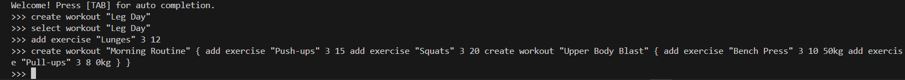
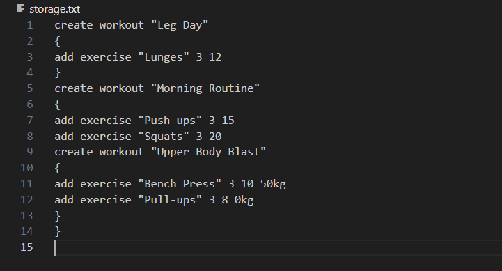
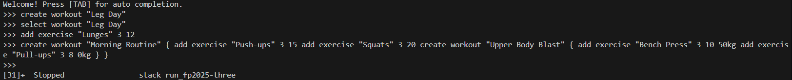
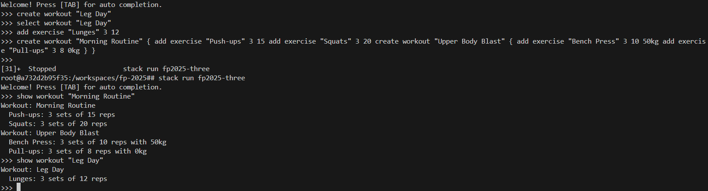

# Workout Planner DSL

This is a **Domain-Specific Language (DSL)** for planning and tracking workouts.  
The domain includes **workouts** and **exercises**, and supports hierarchical workouts (workouts containing sub-workouts).

---

## Domain Description

**Entities:**
- **Workout**: a collection of exercises or other sub-workouts.
- **Exercise**: defined by a name, number of sets, repetitions, and/or optional weight.

**Operations:**
- `create workout <name> { ... }`: create a new workout with nested exercises or sub-workouts.
- `add exercise <exercise> <sets> <reps>`: add an exercise to a workout without weight.
- `add exercise <exercise> <sets> <reps> <weight>`: add an exercise to a workout with weight.
- `remove exercise <exercise>`: remove an exercise.
- `start <workout>`: begin a workout.
- `stop <workout>`: stop workout.
- `show all workouts`: list all workouts.
- `show workout <workout>`: show a specific workout and its contents.
- `select workout <name> { ... }`: select an existing workout and apply nested operations.
- `dump examples`: show example commands.

**Recursive element:**  
- `create workout` allows **recursive nesting of workouts and commands**.


---

## Examples
```haskell
create workout "Morning Routine" 
{
    add exercise "Push-ups" 3 15
    add exercise "Squats" 3 20
    create workout "Upper Body Blast" 
    {
        add exercise "Bench Press" 3 10 50
        add exercise "Pull-ups" 3 8 0
    }
}
select workout "Morning Routine" 
{
    add exercise "Deadlift" 5 5 100
    remove exercise "Push-ups"
    create workout "Leg Day" 
    {
        add exercise "Lunges" 3 12
    }
}
show all workouts
show workout "Morning Routine"
start "Morning Routine"
stop "Morning Routine"
dump examples
```
---

## BNF Grammar

BNF (Backus-Naur Form) is a **formal way to describe the syntax** of your DSL commands.

```bnf
<command> ::= "create workout" <workout_name> "{" <command_list> "}"
            | "add exercise" <exercise_name> <sets> <reps>
            | "add exercise" <exercise_name> <sets> <reps> <weight>
            | "remove exercise" <exercise_name>
            | "start" <workout_name>
            | "stop" <workout_name>
            | "show all workouts"
            | "show workout" <workout_name>
            | "select workout" <workout_name> "{" <command_list> "}"
            | "dump examples"

<command_list> ::= <command> | <command> <command_list>

<workout_name>    ::= <quoted_string>
<exercise_name>   ::= <quoted_string>

<quoted_string> ::= "\"" <chars> "\""

<chars> ::= <char> | <char> <chars>
<char>  ::= "a" | "b" | "c" | "d" | "e" | "f" | "g" | "h" | "i" | "j"
          | "k" | "l" | "m" | "n" | "o" | "p" | "q" | "r" | "s" | "t"
          | "u" | "v" | "w" | "x" | "y" | "z"
          | "A" | "B" | "C" | "D" | "E" | "F" | "G" | "H" | "I" | "J"
          | "K" | "L" | "M" | "N" | "O" | "P" | "Q" | "R" | "S" | "T"
          | "U" | "V" | "W" | "X" | "Y" | "Z"
          | "0" | "1" | "2" | "3" | "4" | "5" | "6" | "7" | "8" | "9"
          | " " | "-" | "_"

<sets>   ::= <integer>
<reps>   ::= <integer>
<weight> ::= <integer> "kg"

<integer> ::= <digit> | <digit> <integer>
<digit>   ::= "0" | "1" | "2" | "3" | "4" | "5" | "6" | "7" | "8" | "9"
```

---
## State Persistence

When thinking about how users interact with our workout app, I kept coming back to a key question: what’s the point in letting users build up complex workout plans if the app just forgets everything the moment it’s closed? Persistence isn’t just a convenience—it’s fundamental to user trust and the integrity of the application state. This is where the notion of state and its persistence become central, especially in a functional paradigm like Haskell, where explicit state modeling is the norm.

My approach is to make the app truly respect the user’s effort. Every change a user makes—adding a workout, tweaking an exercise, or restructuring their plan—gets captured. But instead of serializing some unreadable data structure, I serialize the blueprint: the very DSL commands that built the state in the first place. This means that after each modification, the app converts the entire current state back into a sequence of DSL commands, and writes them to **`storage.txt`**. On startup, these commands are replayed—much like an event sourcing system—reconstructing the exact state as it was left.

### How it Works: Ensuring Speed, Safety, and Integrity

A common problem is that file operations are slow, often making the application freeze or feel unresponsive. This separation is crucial in Haskell because we want to protect the purity of our core logic from the unpredictable nature of side effects. To maintain responsiveness and reliability, file operations are isolated in their own context, strictly separated from the main application logic:

* **Asynchronous I/O via STM and Chans:** Rather than letting `readFile` or `writeFile` block the main thread , all I/O is funneled through a dedicated storage thread, implemented using a `Chan StorageOp`. This thread acts as a consumer for storage jobs, so the main application thread never waits on disk access. STM (Software Transactional Memory) is leveraged to ensure safe communication and atomicity.
* **Loading (`load`):** When the app starts, it reads `storage.txt`, parses each DSL command, and applies them in sequence to an initially empty state. This deterministic replay guarantees a fresh, clean reconstruction of the user’s workouts,this guarantees reliable restoration and ensures we don't end up with partially saved or corrupted workout data.
* **Saving (`save`):** Whenever the user’s state changes, the app serializes the entire state into a command string. This string is handed off to the storage thread, which writes it in one go—ensuring atomicity and reducing the risk of partial writes or corrupt files.

### Serialization: Deliberate Minimalism

A crucial consideration in serialization is deciding *what* to persist. There’s a temptation to log every user action—but that leads to noisy, bloated state. Instead, I made a conscious decision to only store those commands necessary to precisely reconstruct the final state of the workout hierarchy. Things like selecting or deleting an exercise are just in-session steps and are not saved. We maintain a minimalist storage approach, focusing only on the data that truly defines the user's permanent workout plan.

| State Element | Serialized Command | Why? |
| :--- | :--- | :--- |
| **Workout Hierarchy** | `create workout "<name>" { <content> }` | Every workout (including sub-workouts) is serialized as a nested `create workout` block. This approach clearly and simply captures the full structure, guaranteeing that the workout can be reliably rebuilt from an empty state. |
| **Exercises** | `add exercise "<n>" <sets> <reps> <weight>kg` | Each exercise becomes its own command, recorded within the proper workout block. This keeps the mapping between workouts and their exercises explicit and human-readable. |
| **Modification Commands** (`select`, `remove`, etc.) | **Excluded** | Such actions are fleeting and temporary. Instead of logging every step, we focus only on the durable output: the finished state, represented by the exercises that survived the session. |
| **`currentWorkoutName`** | **Ignored** | This is a UI detail: it tracks what the user is currently editing, but has no bearing on the actual data. It defaults to `Nothing` on restart, aligning with pure functional design. |

---

### Some Examples

Let’s take a closer look at what actually gets saved in `storage.txt`, and why these choices matter.

#### Example A: Simple Hierarchy

Imagine a user who’s set up two main workouts, “Morning” and “Evening.” The “Evening” workout even features a sub-workout, “Warmup,” demonstrating nested hierarchies.

| Workout Name | Exercises | Sub-Workouts |
| :--- | :--- | :--- |
| **Morning** | Push-ups (3x15) | None |
| **Evening** | None | Warmup |
| **Warmup** | Stretching (1x10, 0kg) | None |

**What gets saved:**

```
create workout "Morning" { add exercise "Push-ups" 3 15 }
create workout "Evening" { create workout "Warmup" { add exercise "Stretching" 1 10 0kg } }
```

This syntax not only represents the hierarchy clearly, but is also resilient to future changes—if I later want to add more fields or richer semantics, the DSL can evolve in a backward-compatible way.

---

#### Example B: After Modifications

Consider a session where the user:

1. Creates “Plan A” with a “Biceps” exercise.
2. Deletes “Biceps.”
3. Adds a “Triceps” exercise.

The only thing that ends up saved is the final, meaningful state: “Triceps” under “Plan A.” No clutter from past mistakes or transient actions.

| Workout Name | Final Exercises | Sub-Workouts |
| :--- | :--- | :--- |
| **Plan A** | Triceps (3x10, 50kg) | None |

**What gets saved:**

```
create workout "Plan A" { add exercise "Triceps" 3 10 50kg }
```

This approach enforces an “eventual consistency” model: storage only reflects the stable, intentional structure the user wants to keep—not the journey to get there.

*No trace of the deleted “Biceps” exercise, and none of the session commands—just the end result.*

---

### Example Walkthrough: Simple Persistence

Step 1 & 2: Start the app, create two workouts.





Step 3: Quit the app.



Step 4 & 5: Open the app again—everything’s still there, just as you left it.



---
