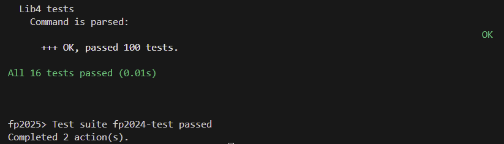
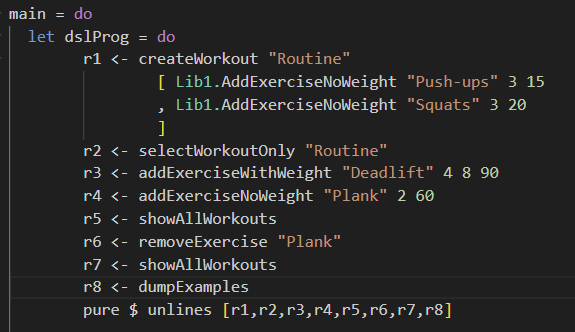
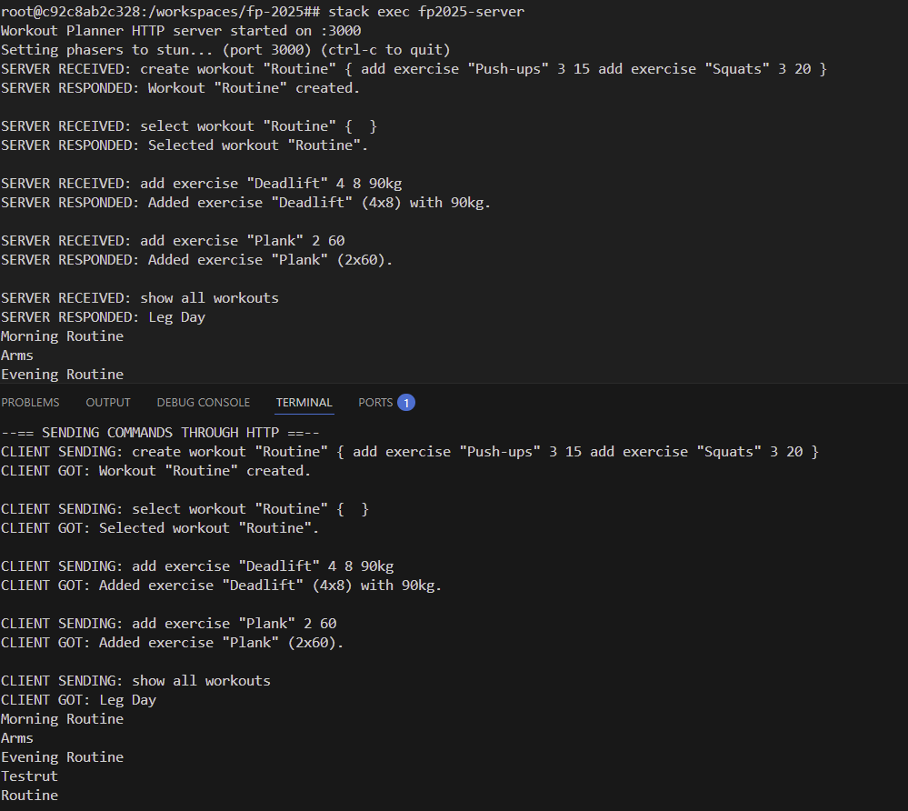
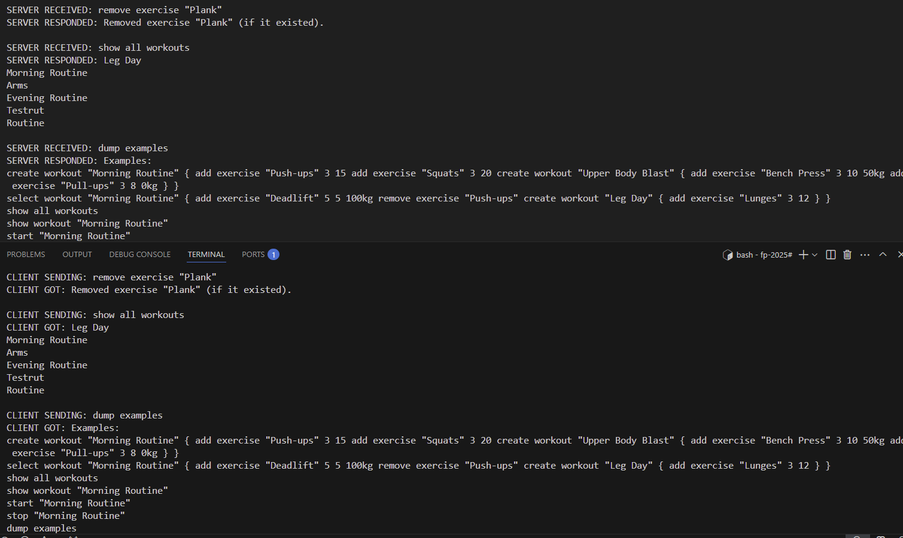
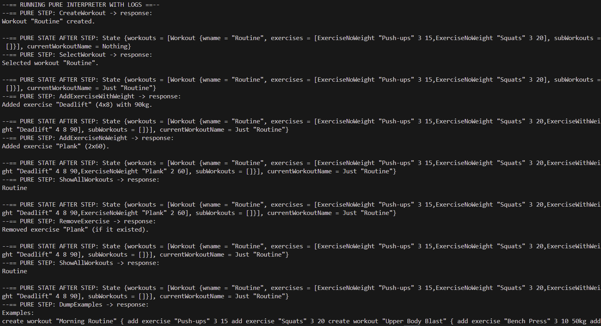
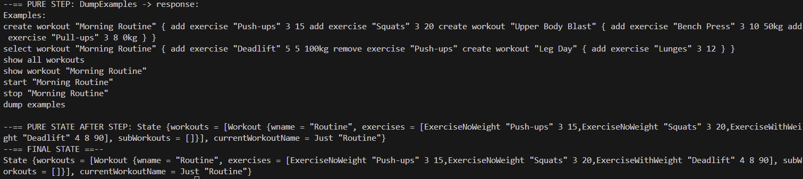

# Workout Planner DSL

This is a **Domain-Specific Language (DSL)** for planning and tracking workouts.  
The domain includes **workouts** and **exercises**, and supports hierarchical workouts (workouts containing sub-workouts).

---

## Domain Description

**Entities:**
- **Workout**: a collection of exercises or other sub-workouts.
- **Exercise**: defined by a name, number of sets, repetitions, and/or optional weight.

**Operations:**
- `create workout <name> { ... }`: create a new workout with nested exercises or sub-workouts.
- `add exercise <exercise> <sets> <reps>`: add an exercise to a workout without weight.
- `add exercise <exercise> <sets> <reps> <weight>`: add an exercise to a workout with weight.
- `remove exercise <exercise>`: remove an exercise.
- `start <workout>`: begin a workout.
- `stop <workout>`: stop workout.
- `show all workouts`: list all workouts.
- `show workout <workout>`: show a specific workout and its contents.
- `select workout <name> { ... }`: select an existing workout and apply nested operations.
- `dump examples`: show example commands.

**Recursive element:**  
- `create workout` allows **recursive nesting of workouts and commands**.


---

## Examples
```haskell
create workout "Morning Routine" 
{
    add exercise "Push-ups" 3 15
    add exercise "Squats" 3 20
    create workout "Upper Body Blast" 
    {
        add exercise "Bench Press" 3 10 50
        add exercise "Pull-ups" 3 8 0
    }
}
select workout "Morning Routine" 
{
    add exercise "Deadlift" 5 5 100
    remove exercise "Push-ups"
    create workout "Leg Day" 
    {
        add exercise "Lunges" 3 12
    }
}
show all workouts
show workout "Morning Routine"
start "Morning Routine"
stop "Morning Routine"
dump examples
```
---

## BNF Grammar

BNF (Backus-Naur Form) is a **formal way to describe the syntax** of your DSL commands.

```bnf
<command> ::= "create workout" <workout_name> "{" <command_list> "}"
            | "add exercise" <exercise_name> <sets> <reps>
            | "add exercise" <exercise_name> <sets> <reps> <weight>
            | "remove exercise" <exercise_name>
            | "start" <workout_name>
            | "stop" <workout_name>
            | "show all workouts"
            | "show workout" <workout_name>
            | "select workout" <workout_name> "{" <command_list> "}"
            | "dump examples"

<command_list> ::= <command> | <command> <command_list>

<workout_name>    ::= <quoted_string>
<exercise_name>   ::= <quoted_string>

<quoted_string> ::= "\"" <chars> "\""

<chars> ::= <char> | <char> <chars>
<char>  ::= "a" | "b" | "c" | "d" | "e" | "f" | "g" | "h" | "i" | "j"
          | "k" | "l" | "m" | "n" | "o" | "p" | "q" | "r" | "s" | "t"
          | "u" | "v" | "w" | "x" | "y" | "z"
          | "A" | "B" | "C" | "D" | "E" | "F" | "G" | "H" | "I" | "J"
          | "K" | "L" | "M" | "N" | "O" | "P" | "Q" | "R" | "S" | "T"
          | "U" | "V" | "W" | "X" | "Y" | "Z"
          | "0" | "1" | "2" | "3" | "4" | "5" | "6" | "7" | "8" | "9"
          | " " | "-" | "_"

<sets>   ::= <integer>
<reps>   ::= <integer>
<weight> ::= <integer> "kg"

<integer> ::= <digit> | <digit> <integer>
<digit>   ::= "0" | "1" | "2" | "3" | "4" | "5" | "6" | "7" | "8" | "9"
```

---
## State Persistence

This version of the program saves and loads its state, so everything you do stays even after you close it.

When the program runs, it:

1. Loads the previous state from a file called storage.txt.

2. Lets you enter and run commands (like adding workouts or exercises).

3. Saves the updated state automatically when you exit or when it’s told to save.

The saved file is just a list of commands — basically a script that can recreate the same state again.
That means if you had workouts and exercises created before, they’ll appear next time you run it.

### How the state maps to commands

The state is turned into a list of DSL commands when saving.
For example, if you have this in memory:

The state is turned into a list of DSL commands when saving.
For example, if you have this in memory:

```haskell
State {
  workouts = [
    Workout "Morning Routine"
      [ ExerciseNoWeight "Squats" 3 20
      , ExerciseWithWeight "Deadlift" 5 5 100
      ]
      []
  ],
  currentWorkoutName = Nothing
}
```

Then the saved file would look like:
```Haskell
create workout "Morning Routine"
{
    add exercise "Squats" 3 20
    add exercise "Deadlift" 5 5 100kg
}
```

When you load the program again, it reads that file, parses the commands, and builds the same state.

### Another example

If you had nested workouts:

```haskell
State {
  workouts = [
    Workout "Full Body" 
      [ExerciseNoWeight "Push-ups" 3 15]
      [Workout "Leg Day"
        [ExerciseNoWeight "Lunges" 3 12]
        []
      ]
  ],
  currentWorkoutName = Nothing
}
```

It would be saved as:
```Haskell
create workout "Full Body"
{
    add exercise "Push-ups" 3 15
    create workout "Leg Day"
    {
        add exercise "Lunges" 3 12
    }
}
```

### Notes

The program saves the state automatically to storage.txt using a background thread.

When you rerun the app, it reconstructs everything exactly as before.


---

### Example Walkthrough:

Step 1 & 2: Start the app, create workouts (check storage.txt file).


Step 3: Quit the app.


Step 4 & 5: Open the app and all the information still there, just as you left it. (Here show workout is used to show that workouts are saved)


---
## Client and Server

### Web Framework

For the server I chose Scotty. It is a Haskell web framework that accepts plain text commands via POST /command.

### QuickCheck tests 
Screenshot showing that QuickCheck tests pass.


### Client-server communication
Screenshots showing the Free Monad DSL being executed and server side logs. 

Free Monad DSL


Client logs show each request and the response and server logs shows received requests and responses.
Client and server communication screenshots: 

First Screenshot:

Second Screenshot:


### Client-side interpreter
Same Free Monad DSL which was sent to server


These screenshots shows the Free‑monad DSL being executed locally. The output shows the response for each DSL command and the state after each step, so you see what changed, like new exercise added or deleted.

First Screenshot:

Second Screenshot:


### Persistence
The server persists state to storage.txt (loaded at startup, saved periodically and on shutdown).

### How to run Server and Client

First build project:
**Stack build**

Then Start the server
**stack exec fp2025-server**

After the server is started run client:
**stack exec fp2025-client**

And you will see Server and Client communication

All info is saved in storage.txt

